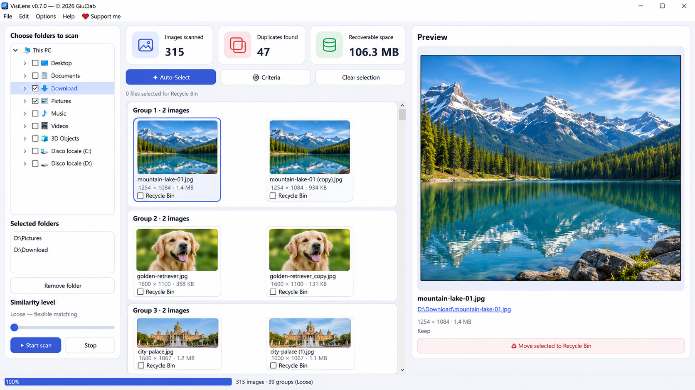

<p align="center">
  
</p>

<h1 align="center">VisiLens</h1>
<h3 align="center">Find visually similar photos. Keep what matters.</h3>

<p align="center">
  A free, open-source duplicate photo finder for Windows 10/11.<br>
  macOS and Linux versions are planned for a future release.<br>
  Review similar images side by side and choose what to keep.
</p>

<p align="center">
  <a href="https://github.com/GiuClab/VisiLens/actions/workflows/build.yml"></a>
  
  
  <a href="LICENSE"></a>
</p>

<p align="center">
  <a href="https://github.com/GiuClab/VisiLens/releases/tag/v0.7.0"></a>
  <br>
  <a href="https://ko-fi.com/giuclab/tip">❤️ Support VisiLens on Ko-fi</a>
</p>

<p align="center">
  <strong>🇬🇧 English</strong> ·
  <a href="docs/README.it.md">🇮🇹 Italiano</a> ·
  <a href="docs/README.de.md">🇩🇪 Deutsch</a> ·
  <a href="docs/README.fr.md">🇫🇷 Français</a>
</p>

<p align="center">
  
</p>
<p align="center"><sub>Illustrative preview based on the VisiLens interface, with generated demonstration photographs. Not an actual scan of a user's photo library.</sub></p>

## About

**VisiLens** helps you find duplicate and visually similar images across folders on your Windows PC. Compare each group in a gallery, inspect a large preview, and decide which files to keep. The program does **not** automatically delete images.

Your photos are scanned **locally**. No account, subscription or cloud upload is required. The optional update checker contacts GitHub only when you click it; project and support links open in your browser.

## ✨ Highlights

- 🖼️ **Find similar photos.** Scan multiple folders and popular image formats.
- 🔍 **Three similarity levels.** Choose Loose, Basic or Strict matching.
- 🗂️ **Visual duplicate groups.** See all matching copies and their dimensions and sizes.
- 👁️ **Large preview.** Inspect an image before deciding what to do.
- ✅ **Manual choice and Auto-Select.** **Auto-Select works in Strict mode only**, never in Loose or Basic. Always review suggestions.
- 🗑️ **Recycle Bin protection.** Files move only after you select them and explicitly confirm.
- ⚡ **Local fingerprint cache.** Speed up repeated scans of unchanged photos.
- 🌍 **Four interface languages.** English, Italian, German and French.

## ⬇️ Download

**VisiLens v0.7.0 · Windows 10/11 · x64**

| Edition | Download | How to use it |
| --- | --- | --- |
| **Windows installer** | **[Download EXE](https://github.com/GiuClab/VisiLens/releases/download/v0.7.0/VisiLens-Setup-0.7.0-x64.exe)** | Run `VisiLens-Setup-0.7.0-x64.exe` to install the application. |
| **Portable version** | **[Download ZIP](https://github.com/GiuClab/VisiLens/releases/download/v0.7.0/VisiLens-Portable-0.7.0-x64.zip)** | Extract the archive, keep `_internal` beside `VisiLens.exe`, then launch the application without installing. |

**[View the official v0.7.0 release](https://github.com/GiuClab/VisiLens/releases/tag/v0.7.0)** for release details and downloads.

> [!NOTE]
> **v0.7.0 is an official, published GitHub Release.** GitHub Actions workflow artifacts are separate build outputs and are not needed to download this version.

> [!WARNING]
> Windows may display a SmartScreen warning because the installer is not digitally signed. Download only from this official repository. Review every suggested duplicate and back up important photographs before moving anything to the Recycle Bin.

## 🧭 How to use VisiLens

1. **Choose folders.** Select one or more folders in the left panel.
2. **Start a scan.** Adjust the similarity slider: Loose, Basic or Strict.
3. **Review groups.** Click thumbnails to see larger previews and file details.
4. **Select copies.** Tick the Recycle Bin checkboxes, or review optional Auto-Select suggestions in Strict mode. Leave the copies you want to keep unchecked.
5. **Confirm.** Move only your explicitly selected images to the Windows Recycle Bin.

Similarity is an estimate, not proof that two photos are interchangeable. VisiLens prioritizes careful comparisons; it can miss some edited or cropped duplicates. **You remain in control of which files are moved.**

## 🔒 Privacy and safety

Image processing, comparisons and the fingerprint cache run on your device. The cache stores local image fingerprints and file paths. VisiLens does not need a user account and does not upload your photos.

The program includes a manual GitHub Releases update check and optional GitHub / Ko-fi links; using these features makes ordinary network requests to those services. Nothing is moved to the Recycle Bin without your confirmation.

## 🤝 Contribute and support

Found a bug or have an idea? [Open an issue](https://github.com/GiuClab/VisiLens/issues). Code contributions and thoughtful feedback are welcome.

VisiLens is free and open source. If it is useful to you, you can [❤️ support development on Ko-fi](https://ko-fi.com/giuclab/tip).

**Made with ❤️ by GiuClab.**

## 🛠️ Development

VisiLens uses Python, PySide6, Pillow, ImageHash, NumPy and Send2Trash. The Windows installer is built with Inno Setup; the portable executable is packaged with PyInstaller.

```bash
python -m pip install -e ".[dev]"
python -m pytest -q
python -m ruff check src tests
python -m visilens.app
```

For matcher details, selection safeguards, installation, builds and earlier development notes, see **[Technical documentation](docs/TECHNICAL.md)**.

## 📄 License

Distributed under the [MIT License](LICENSE). © 2026 GiuClab and VisiLens contributors.

Inspired by the workflow of VisiPics; VisiLens is an independent project and is not affiliated with its authors.
