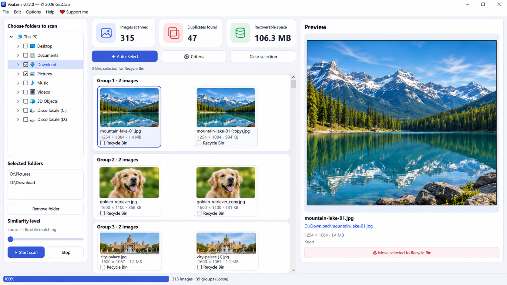

<p align="center"></p>
<h1 align="center">VisiLens</h1>
<h3 align="center">Ähnliche Fotos finden. Wertvolle Bilder behalten.</h3>
<p align="center">Kostenloses Open-Source-Programm zum Finden ähnlicher und doppelter Bilder unter Windows. Versionen für macOS und Linux sind für die Zukunft geplant.</p>

<p align="center">
  <a href="https://github.com/GiuClab/VisiLens/actions/workflows/build.yml"></a>
  
  <a href="../LICENSE"></a>
</p>

<p align="center"><a href="https://github.com/GiuClab/VisiLens/actions/workflows/build.yml"><strong>⬇️ Für Windows herunterladen</strong></a> · <a href="https://ko-fi.com/giuclab/tip">❤️ VisiLens unterstützen</a></p>

<p align="center"><a href="../README.md">🇬🇧 English</a> · <a href="README.it.md">🇮🇹 Italiano</a> · <strong>🇩🇪 Deutsch</strong> · <a href="README.fr.md">🇫🇷 Français</a></p>

<p align="center"></p>
<p align="center"><sub>Illustrative Vorschau der VisiLens-Oberfläche mit generierten Beispielfotos. Keine echte Analyse einer privaten Fotosammlung.</sub></p>

## Über VisiLens

**VisiLens** findet doppelte und visuell ähnliche Bilder in ausgewählten Ordnern auf deinem Windows-PC. Das Programm ordnet Treffer in Gruppen, zeigt Vorschauen und Dateidetails und überlässt dir die Entscheidung, welche Dateien du behalten möchtest.

Die Bildanalyse erfolgt **lokal auf deinem Computer**. Es sind weder Konto noch Abonnement oder Cloud-Upload notwendig. Die Updateprüfung kontaktiert GitHub nur, wenn du sie selbst startest.

## ✨ Funktionen

- 🖼️ **Ähnliche Fotos finden:** mehrere Ordner und gängige Bildformate durchsuchen.
- 🔍 **Drei Vergleichsstufen:** Loose, Basic oder Strict.
- 🗂️ **Übersichtliche Gruppen:** alle Kopien mit Abmessungen und Dateigröße anzeigen.
- 👁️ **Große Vorschau:** ein Foto vor der Auswahl genau ansehen.
- ✅ **Manuelle Auswahl und Auto-Select:** **Auto-Select funktioniert ausschließlich im Strict-Modus**, nicht bei Loose oder Basic. Alle Vorschläge prüfen.
- 🗑️ **Windows-Papierkorb:** Dateien werden erst nach deiner Auswahl und Bestätigung verschoben.
- ⚡ **Lokaler Cache:** beschleunigt erneute Scans unveränderter Dateien.
- 🌍 **Vier Sprachen:** Englisch, Italienisch, Deutsch und Französisch.

## ⬇️ Download

**Windows 10/11 · x64 · Vorabversion 0.7.0**

| Paket | Verwendung |
| --- | --- |
| **Installer** (`VisiLens-Installer-0.7.0-x64`) | Workflow-Artefakt herunterladen, ZIP einmal entpacken und `VisiLens-Setup-0.7.0-x64.exe` starten. |
| **Portable ZIP** (`VisiLens-Portable-0.7.0-x64`) | ZIP einmal entpacken, `_internal` neben `VisiLens.exe` belassen und das Programm ohne Installation starten. |

**[Windows-Pakete über GitHub Actions herunterladen](https://github.com/GiuClab/VisiLens/actions/workflows/build.yml)**: einen erfolgreichen Workflow-Lauf öffnen und unter **Artifacts** das Paket auswählen. Möglicherweise ist eine GitHub-Anmeldung erforderlich.

> [!NOTE]
> Die Downloads sind derzeit **Vorab-Artefakte von GitHub Actions**, keine offiziellen GitHub Releases. Sie können nach Ablauf der Aufbewahrungsfrist verschwinden. Aktuell ist noch kein offizielles Release veröffentlicht.

> [!WARNING]
> Windows SmartScreen kann warnen, weil der Installer nicht digital signiert ist. Lade VisiLens nur aus diesem offiziellen Repository herunter. Sichere wichtige Fotos und prüfe jedes gefundene Duplikat.

## 🧭 Bedienung

1. **Ordner auswählen** – im linken Bereich einen oder mehrere Ordner markieren.
2. **Scan starten** – die Empfindlichkeit auf Loose, Basic oder Strict einstellen.
3. **Treffer prüfen** – Gruppen durchsuchen und Bilder für die große Vorschau anklicken.
4. **Dateien auswählen** – Papierkorb-Kontrollkästchen nutzen oder Auto-Select-Vorschläge im Strict-Modus prüfen. Dateien, die bleiben sollen, nicht markieren.
5. **Bestätigen** – nur ausdrücklich ausgewählte Dateien in den Windows-Papierkorb verschieben.

Visuelle Ähnlichkeit beweist nicht, dass Dateien austauschbar sind. Manche bearbeiteten oder zugeschnittenen Kopien werden möglicherweise nicht erkannt. **Du entscheidest immer selbst, welche Bilder verschoben werden.**

## 🔒 Datenschutz und Sicherheit

Die Fotoanalyse, Vergleiche und der Fingerabdruck-Cache arbeiten lokal. Der Cache speichert lokale Dateipfade und Bild-Fingerabdrücke. Fotos werden nicht hochgeladen; ein Benutzerkonto ist nicht erforderlich.

Nur die manuelle Updateprüfung nimmt bei Bedarf Kontakt zu GitHub auf. GitHub- und Ko-fi-Links werden im Browser geöffnet. Ohne Bestätigung verschiebt VisiLens keine Dateien.

## 🤝 Mithelfen und unterstützen

Du kannst [Fehler melden und Ideen vorschlagen](https://github.com/GiuClab/VisiLens/issues), zum Code beitragen oder die Arbeit über [❤️ Ko-fi](https://ko-fi.com/giuclab/tip) unterstützen.

**Made with ❤️ by GiuClab.**

## 🛠️ Entwicklung

VisiLens basiert auf Python, PySide6, Pillow, ImageHash, NumPy und Send2Trash. Das Windows-Installationspaket wird mit Inno Setup gebaut, die portable Version mit PyInstaller.

```bash
python -m pip install -e ".[dev]"
python -m pytest -q
python -m ruff check src tests
python -m visilens.app
```

Technische Details über Bildvergleich, Cache, Auswahl und Builds stehen in der [technischen Dokumentation (Englisch)](TECHNICAL.md).

## 📄 Lizenz

VisiLens steht unter der [MIT-Lizenz](../LICENSE). © 2026 GiuClab und Mitwirkende.

Das Konzept wurde durch VisiPics angeregt. VisiLens ist ein eigenständiges Projekt und steht in keiner Verbindung zu dessen Autoren.
