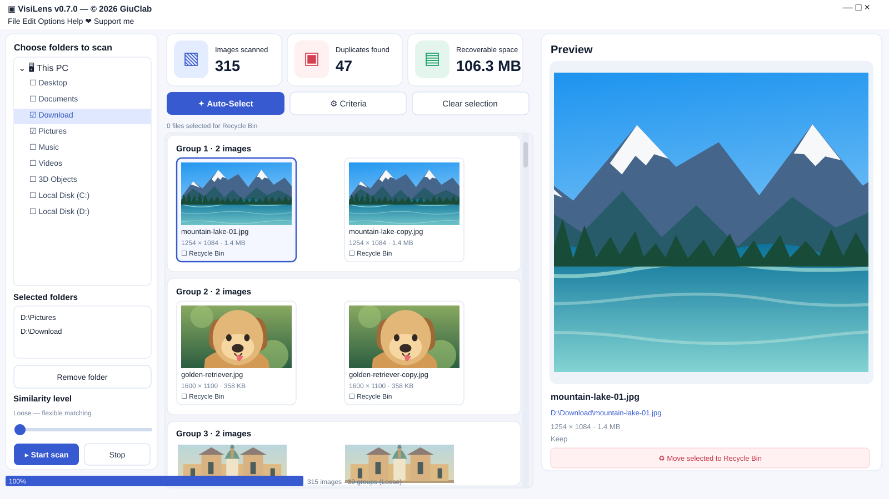

<p align="center"></p>
<h1 align="center">VisiLens</h1>
<h3 align="center">Retrouvez les photos similaires. Gardez l'essentiel.</h3>
<p align="center">Une application gratuite et open source pour rechercher les images en double sur Windows.</p>

<p align="center">
  <a href="https://github.com/GiuClab/VisiLens/actions/workflows/build.yml"></a>
  
  <a href="../LICENSE"></a>
</p>

<p align="center"><a href="https://github.com/GiuClab/VisiLens/actions/workflows/build.yml"><strong>⬇️ Télécharger pour Windows</strong></a> · <a href="https://ko-fi.com/giuclab/tip">❤️ Soutenir VisiLens</a></p>

<p align="center"><a href="../README.md">🇬🇧 English</a> · <a href="README.it.md">🇮🇹 Italiano</a> · <a href="README.de.md">🇩🇪 Deutsch</a> · <strong>🇫🇷 Français</strong></p>

<p align="center"></p>
<p align="center"><sub>Aperçu illustratif de l'interface VisiLens utilisant des images de démonstration générées. Il ne s'agit pas d'une analyse réelle de photos personnelles.</sub></p>

## Présentation

**VisiLens** recherche les images en double ou visuellement similaires dans les dossiers de votre ordinateur Windows. Il regroupe les résultats, affiche des aperçus et les propriétés des fichiers, puis vous laisse décider quelles copies conserver.

L'analyse des images s'effectue **sur votre ordinateur**. Aucun compte, abonnement ou transfert de photos vers le cloud n'est requis. La vérification des mises à jour ne contacte GitHub que lorsque vous la lancez.

## ✨ Fonctionnalités

- 🖼️ **Photos similaires :** analyser plusieurs dossiers et les principaux formats d'image.
- 🔍 **Trois niveaux de comparaison :** Loose, Basic et Strict.
- 🗂️ **Groupes de doublons :** voir toutes les copies avec leurs dimensions et tailles.
- 👁️ **Grand aperçu :** examiner les images avant de décider.
- ✅ **Sélection manuelle et Auto-Select :** suggestions facultatives en mode Strict, toujours à vérifier.
- 🗑️ **Corbeille Windows :** les fichiers ne sont déplacés qu'après sélection et confirmation.
- ⚡ **Cache local :** accélérer les analyses suivantes des fichiers inchangés.
- 🌍 **Quatre langues :** anglais, italien, allemand et français.

## ⬇️ Téléchargement

**Windows 10/11 · x64 · version d'aperçu 0.7.0**

| Package | Utilisation |
| --- | --- |
| **Installateur** (`VisiLens-Installer-0.7.0-x64`) | Télécharger l'artefact, extraire le ZIP une seule fois, puis lancer `VisiLens-Setup-0.7.0-x64.exe`. |
| **Version portable** (`VisiLens-Portable-0.7.0-x64`) | Extraire le ZIP une seule fois, conserver `_internal` à côté de `VisiLens.exe` et lancer l'application sans installation. |

**[Télécharger les versions Windows via GitHub Actions](https://github.com/GiuClab/VisiLens/actions/workflows/build.yml)** : ouvrir une exécution réussie, puis choisir un fichier dans **Artifacts**. Une connexion à GitHub peut être demandée.

> [!NOTE]
> Ces fichiers sont actuellement des **artefacts de test GitHub Actions**, et non des GitHub Releases officielles. Ils peuvent expirer. Aucune release officielle n'a encore été publiée.

> [!WARNING]
> Windows SmartScreen peut afficher un avertissement : l'installateur n'est pas signé numériquement. Téléchargez uniquement depuis ce dépôt officiel. Sauvegardez les photos importantes avant de déplacer des fichiers.

## 🧭 Utilisation

1. **Choisir des dossiers** à gauche de la fenêtre.
2. **Lancer l'analyse** et sélectionner la sensibilité Loose, Basic ou Strict.
3. **Parcourir les groupes** et cliquer sur les miniatures pour voir un aperçu agrandi.
4. **Sélectionner les copies** avec les cases « Recycle Bin », ou vérifier les suggestions Auto-Select en mode Strict. Laisser décochées les photos à conserver.
5. **Confirmer** le déplacement vers la corbeille Windows des seuls fichiers sélectionnés.

La ressemblance visuelle ne garantit pas que deux images soient interchangeables. Certaines copies recadrées ou modifiées peuvent ne pas être détectées. **Vous décidez toujours des fichiers à déplacer.**

## 🔒 Confidentialité et sécurité

L'analyse, la comparaison et le cache des empreintes d'images fonctionnent localement. Le cache conserve des empreintes et des chemins de fichiers locaux. VisiLens ne téléverse pas vos photos et ne nécessite aucun compte.

La vérification manuelle des mises à jour contacte GitHub uniquement sur demande ; les liens GitHub et Ko-fi s'ouvrent dans le navigateur. Aucun déplacement vers la corbeille n'est effectué sans confirmation.

## 🤝 Contribuer et soutenir

Vous pouvez [signaler un problème ou proposer une idée](https://github.com/GiuClab/VisiLens/issues), contribuer au code ou soutenir le projet sur [❤️ Ko-fi](https://ko-fi.com/giuclab/tip).

**Made with ❤️ by GiuClab.**

## 🛠️ Développement

VisiLens utilise Python, PySide6, Pillow, ImageHash, NumPy et Send2Trash. L'installateur Windows utilise Inno Setup, et la version portable utilise PyInstaller.

```bash
python -m pip install -e ".[dev]"
python -m pytest -q
python -m ruff check src tests
python -m visilens.app
```

Pour le moteur de comparaison, le cache, les sélections et les instructions de compilation, consultez la [documentation technique (en anglais)](TECHNICAL.md).

## 📄 Licence

VisiLens est distribué sous [licence MIT](../LICENSE). © 2026 GiuClab et contributeurs.

Le fonctionnement s'inspire de VisiPics, mais VisiLens est un projet indépendant et n'est pas affilié à ses auteurs.
