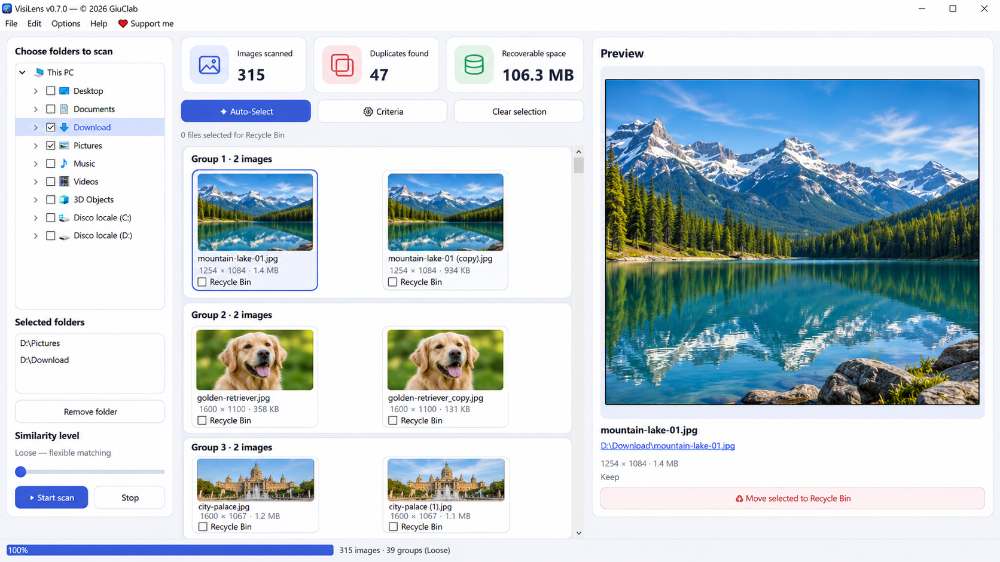

<p align="center"></p>
<h1 align="center">VisiLens</h1>
<h3 align="center">Trova le foto simili. Conserva ciò che conta.</h3>
<p align="center">Un programma gratuito e open source per trovare immagini duplicate su Windows. Le versioni macOS e Linux sono previste in futuro.</p>

<p align="center">
  <a href="https://github.com/GiuClab/VisiLens/actions/workflows/build.yml"></a>
  
  <a href="../LICENSE"></a>
</p>

<p align="center"><a href="https://github.com/GiuClab/VisiLens/actions/workflows/build.yml"><strong>⬇️ Scarica per Windows</strong></a> · <a href="https://ko-fi.com/giuclab/tip">❤️ Supporta VisiLens</a></p>

<p align="center"><a href="../README.md">🇬🇧 English</a> · <strong>🇮🇹 Italiano</strong> · <a href="README.de.md">🇩🇪 Deutsch</a> · <a href="README.fr.md">🇫🇷 Français</a></p>

<p align="center"></p>
<p align="center"><sub>Anteprima illustrativa basata sull'interfaccia di VisiLens, con fotografie dimostrative generate. Non rappresenta una scansione reale di fotografie personali.</sub></p>

## Cos'è VisiLens?

**VisiLens** cerca immagini duplicate o visivamente simili nelle cartelle del tuo computer. Raggruppa le fotografie, mostra anteprime e dettagli dei file e ti lascia decidere quali copie conservare.

Funziona **in locale**: non devi creare un account, abbonarti o caricare le fotografie sul cloud. Il controllo degli aggiornamenti contatta GitHub soltanto quando premi il relativo pulsante.

## ✨ Funzionalità

- 🖼️ **Immagini simili:** analizza più cartelle e i principali formati fotografici.
- 🔍 **Tre livelli:** Loose, Basic e Strict, per regolare la somiglianza.
- 🗂️ **Gruppi di duplicati:** mostra tutte le copie, con dimensioni e peso dei file.
- 👁️ **Anteprima grande:** osserva la fotografia prima di prendere una decisione.
- ✅ **Selezione manuale e Auto-Select:** **Auto-Select funziona soltanto in modalità Strict**, non con Loose o Basic. Controlla sempre i suggerimenti.
- 🗑️ **Cestino di Windows:** nessun file viene spostato senza selezione e conferma esplicita.
- ⚡ **Cache locale:** accelera le scansioni ripetute dei file non modificati.
- 🌍 **Quattro lingue:** inglese, italiano, tedesco e francese.

## ⬇️ Download

**Windows 10/11 · 64 bit · versione di anteprima 0.7.0**

| Pacchetto | Come utilizzarlo |
| --- | --- |
| **Installer** (`VisiLens-Installer-0.7.0-x64`) | Scarica l'artefatto, estrai lo ZIP una volta e avvia `VisiLens-Setup-0.7.0-x64.exe`. |
| **Portatile** (`VisiLens-Portable-0.7.0-x64`) | Estrai lo ZIP una volta, conserva la cartella `_internal` accanto a `VisiLens.exe` e avvia il programma. |

**[Scarica i pacchetti da GitHub Actions](https://github.com/GiuClab/VisiLens/actions/workflows/build.yml)**: apri una compilazione completata con successo e trova la sezione **Artifacts**. GitHub potrebbe richiedere l'accesso per scaricare gli artefatti.

> [!NOTE]
> Al momento i pacchetti sono anteprime distribuite tramite GitHub Actions, **non release ufficiali**. Gli artefatti possono scadere. Non risultano ancora release pubblicate nella sezione Releases.

> [!WARNING]
> Windows potrebbe mostrare un avviso SmartScreen perché l'installer non è firmato digitalmente. Scarica VisiLens esclusivamente dal repository ufficiale. Conserva un backup delle fotografie importanti.

## 🧭 Come si usa

1. **Scegli le cartelle** da analizzare nel pannello a sinistra.
2. **Avvia la scansione** e regola la sensibilità tra Loose, Basic e Strict.
3. **Controlla i gruppi** e fai clic sulle miniature per vedere l'anteprima.
4. **Scegli le copie** usando le caselle «Recycle Bin», oppure verifica i suggerimenti Auto-Select in modalità Strict. Non selezionare le copie da conservare.
5. **Conferma** per spostare nel Cestino soltanto i file che hai selezionato.

La somiglianza visiva non garantisce che le immagini siano intercambiabili. Alcune copie modificate o ritagliate potrebbero non essere riconosciute. **La scelta finale resta sempre all'utente.**

## 🔒 Privacy e sicurezza

L'analisi, il confronto e la cache delle impronte digitali delle immagini avvengono sul tuo computer. La cache contiene impronte e percorsi locali, non fotografie caricate online. Non è richiesto alcun account.

Il programma può aprire GitHub per verificare manualmente gli aggiornamenti e i collegamenti GitHub e Ko-fi nel browser. Nessun file viene spostato nel Cestino senza conferma.

## 🤝 Contribuisci

Puoi [segnalare problemi e proporre miglioramenti](https://github.com/GiuClab/VisiLens/issues), contribuire al codice o sostenere lo sviluppo tramite [❤️ Ko-fi](https://ko-fi.com/giuclab/tip).

**Made with ❤️ by GiuClab.**

## 🛠️ Sviluppo

VisiLens utilizza Python, PySide6, Pillow, ImageHash, NumPy e Send2Trash. Installer Windows con Inno Setup; versione portatile con PyInstaller.

```bash
python -m pip install -e ".[dev]"
python -m pytest -q
python -m ruff check src tests
python -m visilens.app
```

Per i dettagli tecnici sul confronto, la cache, la selezione e la compilazione: [documentazione tecnica (in inglese)](TECHNICAL.md).

## 📄 Licenza

VisiLens è distribuito sotto [licenza MIT](../LICENSE). © 2026 GiuClab e collaboratori.

Ispirato al funzionamento di VisiPics, ma sviluppato come progetto indipendente e non affiliato ai suoi autori.
